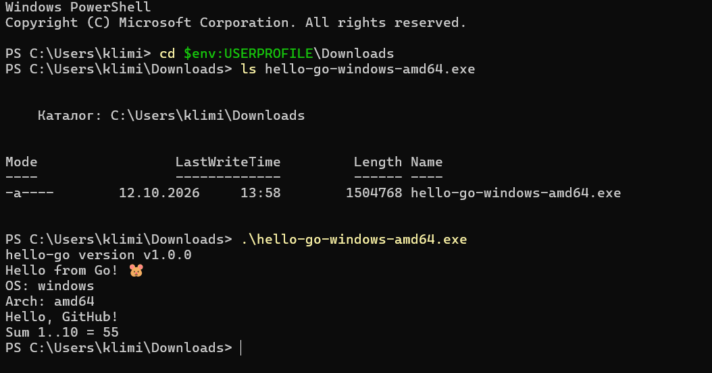

# hello-go

Учебный проект с CI/CD на GitHub Actions для Go-приложения с публикацией бинарников в **GitHub Releases**.

## 📌 Цель работы

Научиться автоматически собирать и публиковать бинарники под **5 платформ** (Linux, macOS, Windows) при push тега `v*`.

## 🎯 Что делает CI/CD

**Job `test`** — запускается при любом push:
- `gofmt -l .` — проверка форматирования
- `go vet ./...` — линтер
- `go test ./... -v` — тесты
- `CGO_ENABLED=0 go build` — smoke-сборка

**Job `release`** — запускается **только при push тега `v*`**:
- Матричная сборка под 5 платформ:
  - `linux-amd64`
  - `linux-arm64`
  - `darwin-amd64` (macOS Intel)
  - `darwin-arm64` (macOS Apple Silicon)
  - `windows-amd64.exe`
- Публикация файлов в **GitHub Release**

## 📂 Структура проекта

```
hello-go_bin/
├── .github/workflows/ci.yml
├── greeting/
│   ├── greeting.go
│   └── greeting_test.go
├── .gitignore
├── go.mod
├── main.go
└── README.md
```

## 🐹 Основной код

**`greeting/greeting.go`:**
```go
package greeting

import "fmt"

func Greet(name string) string {
	return fmt.Sprintf("Hello, %s!", name)
}

func SumRange(from, to int) int {
	sum := 0
	for i := from; i <= to; i++ {
		sum += i
	}
	return sum
}
```

**`main.go`:**
```go
package main

import (
	"fmt"
	"os"
	"runtime"
	"hello-go/greeting"
)

var version = "dev"

func main() {
	fmt.Printf("hello-go version %s\n", version)
	fmt.Println("Hello from Go! 🐹")
	fmt.Printf("OS: %s\n", runtime.GOOS)
	fmt.Printf("Arch: %s\n", runtime.GOARCH)
	fmt.Println(greeting.Greet("GitHub"))
	fmt.Printf("Sum 1..10 = %d\n", greeting.SumRange(1, 10))
}
```

## 🚀 Создание релиза

```bash
git tag v1.0.0
git push origin v1.0.0
```

Workflow автоматически:
1. Прогонит тесты
2. Соберёт 5 бинарников параллельно
3. Создаст GitHub Release `v1.0.0` с прикреплёнными файлами

## 📥 Скачивание и запуск бинарника

### Windows

```powershell
Invoke-WebRequest `
  -Uri "https://github.com/xem1zo/hello-go-releases/releases/download/v1.0.0/hello-go-windows-amd64.exe" `
  -OutFile "hello-go.exe"

.\hello-go.exe
```

### Linux / macOS

```bash
wget https://github.com/xem1zo/hello-go-releases/releases/download/v1.0.0/hello-go-linux-amd64
chmod +x hello-go-linux-amd64
./hello-go-linux-amd64
```

Ожидаемый вывод:
```
hello-go version v1.0.0
Hello from Go! 🐹
OS: linux
Arch: amd64
Hello, GitHub!
Sum 1..10 = 55
```

> 💡 **Первая строка** — `version v1.0.0` — доказывает, что версия внедрена через `-ldflags "-X main.version=..."` при компиляции.

## 📸 Результат запуска



## ✅ Результат

- **Job `test`** — зелёный при каждом push в `main`
- **Job `release`** — запускается по тегу `v*`, создаёт Release с 5 бинарниками

**Actions:** https://github.com/xem1zo/hello-go-releases/actions  
**Releases:** https://github.com/xem1zo/hello-go-releases/releases

## 📝 Вывод

Освоил:
- Cross-compilation через `GOOS`/`GOARCH` (без установки целевой платформы)
- Матричные сборки в GitHub Actions (5 параллельных job'ов)
- Публикацию бинарников через `softprops/action-gh-release@v2`
- Семантическое версионирование (теги `v1.0.0`)
- Внедрение версии в бинарник через `-ldflags -X`
- Разницу между CI (проверка) и CI/CD (публикация артефакта)
- Отличия Releases (бинарники) от GHCR (Docker-образы)